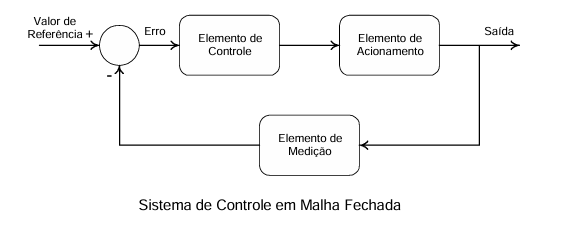
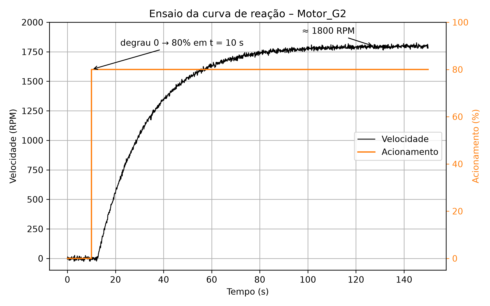
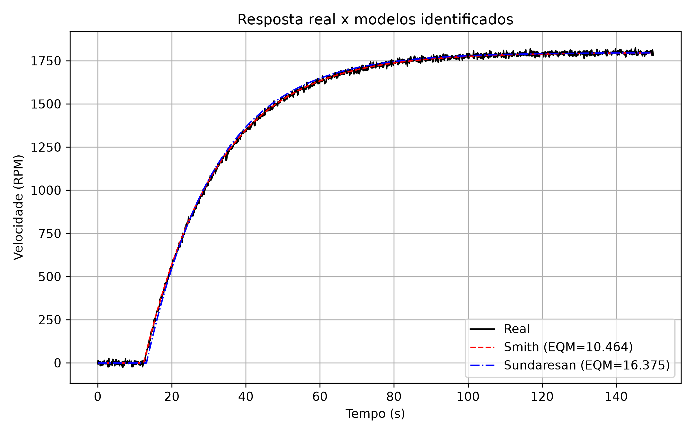
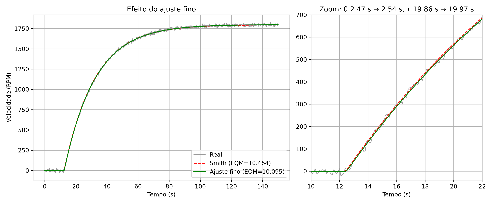
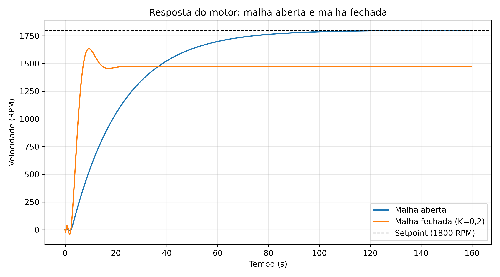
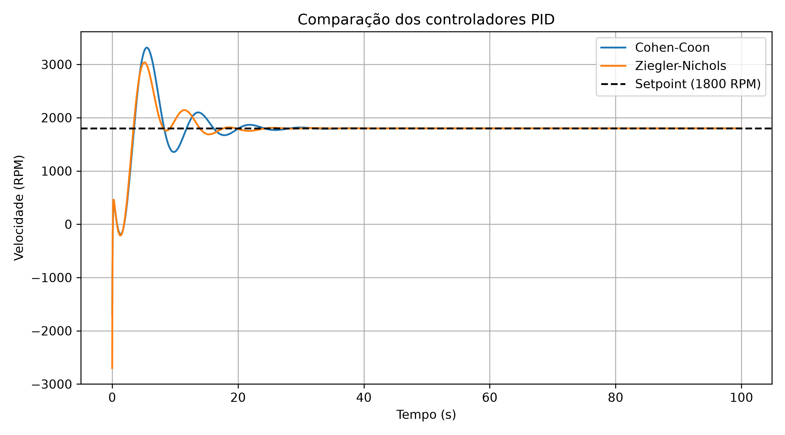
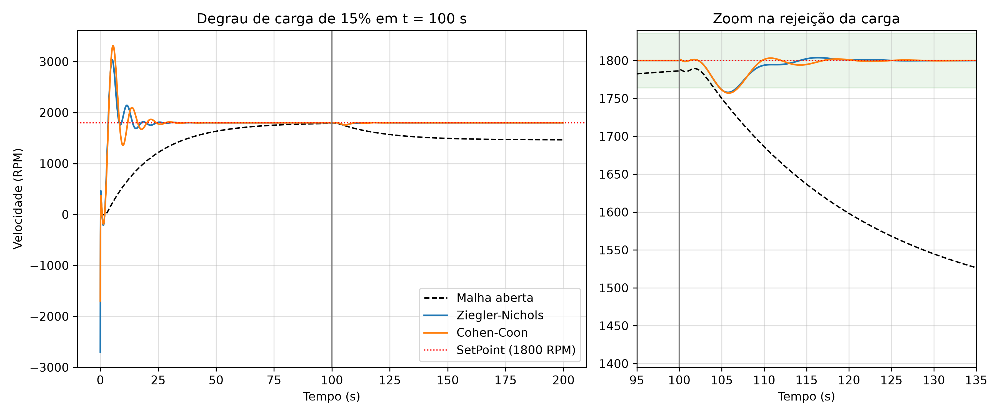

# Identificação de Processos e Sintonia de Controladores PID
**C13 - Sistemas Embarcados**
Projeto Prático 1

**Grupo 2** · Planta: **Motor CC (controle de velocidade)** 
            · Métodos de sintonia: **Ziegler-Nichols Malha Aberta** e **Cohen-Coon**
            · Critério de desempenho: **menor tempo de resposta**

## Proposta 

A aplicação identifica o modelo de um motor CC a partir de um ensaio de curva de reação (resposta ao degrau em malha aberta), sintoniza controladores PID por métodos clássicos e permite ao usuário testar a malha fechada em uma interface gráfica com login, seleção de método de sintonia, sintonia manual e métrica de desempenho (tempo de subida, tempo de acomodação e overshoot).

### Estrutura do repositório

| Caminho | Conteúdo |
|---|---|
| `dataset/Motor_G2.mat` | Ensaio da curva de reação do Grupo 2 (`t`, `Degrau`, `Saida` e metadados) |
| `identificação/identificacao.py` | Leitura e validação do dataset, métodos de Smith e Sundaresan, EQM e ajuste fino |
| `identificação/curva_reacao.py` | Item 1: gráfico do ensaio da curva de reação |
| `identificação/main_identificacao.py` | Itens 1 a 3: identifica, compara, faz o ajuste fino e salva `modelo_identificado.json` |
| `identificação/sintonia_ziegler_nichols.py`, `sintonia_cohen_coon.py` | Regras de sintonia das Tabelas 1 e 5 do enunciado |
| `identificação/comparar_malhas.py` | Item 4: malha aberta × malha fechada |
| `identificação/comparar_sintonias.py` | Itens 5 e 6: ZN × Cohen-Coon |
| `controle/malha_fechada.py` | Núcleo de simulação (planta FOPDT + Padé, PID, métricas, degrau de carga) |
| `controle/degrau_carga.py` | Extra: rejeição de um degrau de carga |
| `interface/login.py`, `interface/interface_pid.py` | Item 7: tela de login e interface com as abas Identificação e Controle PID |
| `identificação/interface_identificacao.py` | Aba Identificação da interface |
| `docs/` | Textos de apoio de cada item |
| `figuras/` | Todos os gráficos, salvos em 300 dpi |

### Como executar

Instale as dependências e rode tudo **a partir da pasta raiz** do projeto:

```bash
pip install -r requirements.txt
python "identificação/curva_reacao.py"        # item 1 (gráfico do ensaio)
python "identificação/main_identificacao.py"   # itens 1 a 3 (gera o JSON e as figuras de identificação)
python "identificação/comparar_malhas.py"      # item 4
python "identificação/comparar_sintonias.py"   # itens 5 e 6
python controle/degrau_carga.py                # extra: degrau de carga
python interface/login.py                      # item 7 (precisa do .env, veja abaixo)
```

Os scripts também funcionam como módulo, por exemplo `python -m identificação.main_identificacao`.

#### Configurar usuário e senha da interface

Antes de abrir a interface, crie o arquivo `.env` na pasta raiz do projeto a partir do modelo:

```powershell
Copy-Item .env.example .env
```

Edite o `.env` e defina as credenciais que serão usadas na tela de autenticação:

```dotenv
LOGIN_USERNAME=seu_usuario
LOGIN_PASSWORD=sua_senha
```

Inicie a interface pela tela de login, também a partir da pasta raiz:

```bash
python interface/login.py
```

O arquivo `.env` é local e está ignorado pelo Git; não o envie ao repositório. O `.env.example` é apenas um modelo, então cada pessoa deve criar seu próprio `.env`. Se as variáveis `LOGIN_USERNAME` e `LOGIN_PASSWORD` não estiverem definidas, a interface informa que é necessário configurar o arquivo.

## Parte teórica

### 1. Funcionamento da planta



*Figura 1: Sistema de controle em malha fechada. Fonte: FUENTES (2005).*

O motor CC é bastante usado em acionamentos de velocidade variável justamente pela facilidade de controlar sua rotação e seu torque (FUENTES, 2005). Ele é formado por uma parte fixa, o **estator**, que gera o fluxo magnético principal $\Phi$, e uma parte girante, a **armadura**, alimentada por escovas e comutador. A interação entre o campo do estator e a corrente da armadura produz o torque que gira o eixo, e o comutador garante que esse torque mantenha sempre o mesmo sentido.

Considerando excitação independente ou ímãs permanentes, o fluxo $\Phi$ é constante, e a velocidade passa a ser controlada pela tensão aplicada na armadura (FUENTES, 2005). Nessa condição, o motor pode ser resumido em duas relações:

$$T = K_t\,I_a \qquad\qquad E = K_e\,\omega$$

O torque é proporcional à corrente de armadura, e a **força contraeletromotriz** $E$ é proporcional à velocidade. É ela que faz a resposta se estabilizar: conforme o motor acelera, $E$ aumenta, a corrente e o torque diminuem, e a velocidade para de crescer quando o torque equilibra as perdas e a carga.

Incluindo a indutância da armadura $L_a$, a inércia $J$ e o atrito viscoso $b$, o modelo dinâmico do motor é de segunda ordem (OGATA, 2010):

$$\frac{\Omega(s)}{V_a(s)} = \frac{K_t}{(L_a s + R_a)(J s + b) + K_t K_e}$$

Um polo vem da parte elétrica ($L_a/R_a$) e o outro da parte mecânica ($J/b$). Como a constante elétrica é muito mais rápida, a dinâmica mecânica domina, e o motor pode ser aproximado por um modelo de **primeira ordem com atraso**:

$$G(s) = \frac{k}{\tau s + 1}\,e^{-\theta s}$$

O atraso $\theta$ não aparece nas equações ideais do motor. Em um sistema real, ele vem de fatores como o tempo de amostragem do controlador, a filtragem da medição e o atrito estático. Já a constante de tempo identificada, de cerca de 20 s, é alta para um motor pequeno, o que indica um motor acionando uma carga com bastante inércia.

#### Sensores e atuadores

Em uma implementação real, a malha da Figura 1 é fechada por um **microcontrolador** (como Arduino, ESP32 ou STM32), que lê a velocidade do motor, calcula a ação do PID e comanda o acionamento.

**Atuador.** O microcontrolador não fornece a corrente que o motor precisa. Por isso, a tensão de armadura é aplicada por um **driver de potência em ponte H**, por exemplo o L298N para motores pequenos ou o BTS7960 para correntes maiores. O controlador comanda o driver por **PWM**: a tensão média na armadura é proporcional ao *duty cycle*, e é esse sinal, de 0 a 100 %, que faz o papel da entrada do modelo. A ponte H também permite inverter o sentido de giro e frear o motor.

**Sensores de velocidade.**
- **Encoder incremental** (óptico ou magnético), acoplado ao eixo. Ele gera um número fixo de pulsos por volta, e a velocidade é obtida contando os pulsos em um intervalo de tempo. É a opção mais comum em sistemas embarcados, por ser digital e preciso.
- **Tacogerador**, um pequeno gerador CC no eixo cuja tensão de saída é proporcional à velocidade. Fornece um sinal analógico contínuo, lido pelo conversor A/D.
- **Sensor de efeito Hall** com um ímã no eixo. Funciona como um encoder de poucos pulsos por volta: é mais simples e barato, mas tem menor resolução em baixas velocidades.

Também é possível usar um **sensor de corrente** na armadura, como o ACS712, para proteger o motor contra sobrecorrente. A forma de medir a velocidade influencia o modelo: o intervalo de contagem dos pulsos e a filtragem do sinal introduzem atraso, o que contribui para o $\theta$ identificado.

### 2. Variáveis do processo

| Variável | Grandeza | Faixa de operação |
|---|---|---|
| **Controlada (PV)** | Velocidade de rotação do eixo | 0 a ≈ 2250 RPM; ponto de operação do ensaio: 1800 RPM |
| **Manipulada (MV)** | Sinal de acionamento do driver (*duty cycle* do PWM) | 0 a 100 %; o ensaio aplicou um degrau de 0 para 80 % |

As faixas vêm do próprio ensaio. O dataset informa a unidade da saída (RPM) e descreve o ensaio como um degrau de 80 % com velocidade alvo de 1800 RPM. Com o ganho identificado, $k \approx 22{,}5$ RPM/%, o acionamento máximo (100 %) levaria o motor a cerca de $22{,}5 \times 100 \approx 2250$ RPM, supondo que ele se comporte de forma linear até esse ponto. Na prática, a faixa útil também é limitada pela tensão nominal do motor e pela corrente máxima do driver. Por isso o SetPoint deve ficar abaixo do máximo, deixando margem para o controlador corrigir perturbações.

**Principais perturbações:**
- **Variação da carga no eixo:** um aumento do torque resistente reduz a velocidade para o mesmo acionamento. É a perturbação mais importante no controle de velocidade e a principal razão para fechar a malha.
- **Variação da tensão de alimentação:** quedas na fonte ou na bateria reduzem a tensão efetiva na armadura, mesmo com o *duty cycle* constante.
- **Aquecimento do motor:** a resistência da armadura aumenta com a temperatura, o que muda a relação entre tensão, corrente e torque ao longo da operação.
- **Atrito variável:** o desgaste das escovas e mudanças na lubrificação dos mancais alteram as perdas mecânicas.
- **Ruído de medição:** a leitura de velocidade oscila em torno do valor real. Nos dados do ensaio, o desvio padrão da saída em regime é de cerca de 10 RPM, o que explica por que o EQM da identificação não fica abaixo de ≈ 10 RPM.

**Faixas das perturbações.** Os valores abaixo são faixas típicas para um motor CC pequeno acionado por PWM. O efeito foi estimado com o modelo identificado no ponto de operação de 1800 RPM:

| Perturbação | Faixa típica | Efeito sem controle (malha aberta) |
|---|---|---|
| Carga no eixo | 0 a 20 % do acionamento equivalente: a 1800 RPM o PWM já está em 80 %, então essa é a carga máxima que o controlador consegue compensar sem saturar | Queda de até $k \times 20 \approx 450$ RPM |
| Tensão de alimentação | ±10 % da nominal (fonte ou bateria descarregando) | A velocidade acompanha a tensão: ≈ ±180 RPM |
| Aquecimento do motor | $R_a$ aumenta ≈ 0,4 %/°C no cobre; de 25 °C a 75 °C, ≈ +20 % | Aumenta a queda de velocidade sob carga |
| Atrito variável | Poucos % do torque nominal | Desvios de algumas dezenas de RPM |
| Ruído de medição | Desvio padrão ≈ 10 RPM (9,3 a 10,5 RPM no ensaio) | Não muda a média, mas é amplificado pela ação derivativa |

## Parte prática

### 1. Dataset do grupo

O ensaio do Grupo 2 está em `dataset/Motor_G2.mat`. São 1501 amostras em 150 s ($\Delta t$ = 0,1 s). Em t = 10 s, a entrada (`Degrau`, *duty cycle* do PWM em %) passa de 0 para 80 %, e a saída (`Saida`, em RPM) sobe de ≈ 0 até ≈ 1800 RPM. O arquivo também traz metadados: a unidade da saída (`unidade_saida = "RPM"`), uma descrição do ensaio e a velocidade alvo (`rpm_final = 1800`), que a interface usa como SetPoint inicial.



*Figura 2: Ensaio da curva de reação do Grupo 2 (`python "identificação/curva_reacao.py"`). A velocidade só começa a subir cerca de 2,5 s depois do degrau, que é o atraso θ, e chega a ≈ 1800 RPM sem sobressinal.*

### 2. Identificação: método e modelo

**Modelo.** A curva de reação é monotônica, sem sobressinal, com formato em "S" e um atraso antes de reagir. É a resposta típica de um sistema de **primeira ordem com atraso (FOPDT)**, coerente com a física do motor: o polo elétrico é muito mais rápido que o mecânico (seção 1). Por isso o modelo adotado é $G(s) = \frac{k}{\tau s + 1}e^{-\theta s}$.

**Parâmetros pelos dois métodos** (`python "identificação/main_identificacao.py"`). O método de Smith (SMITH, 1972) usa os instantes em que a resposta normalizada passa por 28,3 % e 63,2 % do valor final; o de Sundaresan (SUNDARESAN; KRISHNASWAMY, 1978), por 35,3 % e 85,3 %:

| Método | k (RPM/%) | τ (s) | θ (s) | θ/τ | EQM (RPM) |
|---|---|---|---|---|---|
| **Smith** | 22,47 | 19,86 | 2,47 | 0,124 | **10,46** |
| Sundaresan | 22,47 | 18,81 | 3,21 | 0,171 | 16,37 |

**Método escolhido: Smith**, por ter o menor EQM. A função de transferência identificada é:

$$G_{Smith}(s) = \frac{22{,}47}{19{,}86\,s + 1}\,e^{-2{,}47\,s}$$

**Por que Smith foi melhor, mesmo com ruído.** O enunciado indica Sundaresan para dados com mais ruído. Neste ensaio, porém, o ponto de 85,3 % usado por Sundaresan fica na parte final da curva, que é mais plana. Ali a inclinação da resposta normalizada, $(1-0{,}853)/\tau$, é 2,5 vezes menor do que no ponto de 63,2 % de Smith, $(1-0{,}632)/\tau$. Com uma inclinação menor, o mesmo ruído de ≈ 10 RPM desloca muito mais o instante em que a curva cruza o nível. Nos dados, a curva cruza os 85,3 % em 39,5 s, 1,2 s antes do modelo sem ruído; nos outros três pontos a diferença é de no máximo 0,1 s. Esse cruzamento antecipado reduz τ (18,81 s) e aumenta θ (3,21 s) pela fórmula $\theta = 1{,}3t_1 - 0{,}29t_2$. Na figura, a curva de Sundaresan começa a subir atrasada.



### 3. Validação e ajuste fino

A aproximação de Smith é **satisfatória**: o EQM de 10,46 RPM é praticamente igual ao desvio padrão do ruído de medição (≈ 10 RPM). Ou seja, o que sobra de erro é quase todo ruído, e não diferença de dinâmica.

Mesmo assim, foi feito um **ajuste fino**. Partindo dos valores de Smith, os três parâmetros foram refinados para minimizar o EQM (Nelder-Mead):

| Parâmetro | Smith | Ajuste fino | Variação |
|---|---|---|---|
| k (RPM/%) | 22,47 | 22,50 | +0,1 % |
| τ (s) | 19,86 | 19,97 | +0,6 % |
| θ (s) | 2,47 | 2,54 | +2,8 % |
| EQM (RPM) | 10,46 | 10,10 | −3,5 % |

$$G(s) = \frac{22{,}50}{19{,}97\,s + 1}\,e^{-2{,}54\,s}$$

O reflexo na resposta aparece no início da subida (zoom na figura): com θ um pouco maior, o modelo ajustado começa a subir junto com os dados, enquanto o de Smith se adianta. Como tem o menor EQM, **o modelo do ajuste fino é o adotado em todo o restante do projeto**.



### 4. Malha aberta × malha fechada

Veja o [exemplo do item 4](#exemplo-item-4-malha-aberta--malha-fechada) e o texto completo em [`docs/comparacao_malhas.txt`](docs/comparacao_malhas.txt). Em resumo, com um ganho K = 0,2 a malha fechada sobe 12,7 vezes mais rápido e acomoda 6 vezes mais rápido que a malha aberta, mas fica com 18 % de erro em regime, que só a ação integral elimina.



### 5. Sintonia do PID (Tabela 8)

Os parâmetros seguem as regras de Ziegler-Nichols em malha aberta (ZIEGLER; NICHOLS, 1993) e de Cohen-Coon (COHEN; COON, 1953), nas Tabelas 1 e 5 do enunciado. Eles foram calculados com o modelo do ajuste fino (k = 22,50, τ = 19,97 s, θ = 2,54 s, θ/τ = 0,127) e simulados com SetPoint de 1800 RPM (`python "identificação/comparar_sintonias.py"`):

| Técnica | Método | Kp (%/RPM) | Ti (s) | Td (s) |
|---|---|---|---|---|
| 1 | Ziegler-Nichols Malha Aberta | 0,4199 | 5,074 | 1,268 |
| 5 | Cohen e Coon | 0,4776 | 5,930 | 0,902 |

| Método | Tempo de subida | Tempo de acomodação (2 %) | Overshoot | Pico | Erro em regime |
|---|---|---|---|---|---|
| Ziegler-Nichols | 1,15 s | **22,74 s** | 68,8 % | 3039 RPM em 5,1 s | 0 |
| Cohen-Coon | 1,20 s | 23,24 s | 84,2 % | 3315 RPM em 5,5 s | 0 |

**Comportamento do sistema controlado.** As duas malhas são estáveis e zeram o erro em regime graças à ação integral. Comparadas com a malha aberta, sobem cerca de 38 vezes mais rápido e acomodam em menos de um terço do tempo. Em compensação, são muito oscilatórias. O ganho crítico do processo é $K_{cr} \approx 0{,}578$, e os dois Kp ficam perto dele: 73 % de $K_{cr}$ no ZN e 83 % no Cohen-Coon. Isso explica os sobressinais altos.

O pico simulado passa de 3000 RPM, acima dos ≈ 2250 RPM que o motor alcança com 100 % de PWM. No motor real, o acionamento saturaria e o pico seria menor, mas a resposta ficaria mais lenta. Se o critério fosse sobressinal, esses ganhos teriam que ser reduzidos.

O Cohen-Coon foi proposto para θ/τ > 0,3, e este processo tem θ/τ = 0,127. Fora da sua faixa, o método fica mais agressivo que o ZN.

O texto completo dos itens 5 e 6 está em [`docs/comparacao_sintonias.txt`](docs/comparacao_sintonias.txt).

> As duas curvas começam com um pico negativo. Ele é efeito da derivada ideal combinada com a aproximação de Padé, e não do motor (veja as [Observações](#observações)). As métricas ignoram esse trecho.



### 6. Método com menor tempo de resposta

O critério do Grupo 2 é **(a) menor tempo de resposta**, tomado como o **tempo de acomodação** (critério de 2 %): o tempo que o motor leva para chegar à velocidade desejada e ficar nela.

**O método mais rápido é o Ziegler-Nichols**, com 22,74 s contra 23,24 s do Cohen-Coon. Ele também tem tempo de subida um pouco menor (1,15 s contra 1,20 s) e sobressinal menor (69 % contra 84 %). No extra de degrau de carga, o ZN também recupera a velocidade mais rápido (6,81 s contra 6,94 s).

**Por que o ZN se adequa melhor a esse critério:**
- **Foi feito para ser rápido.** O ZN em malha aberta foi projetado para uma razão de decaimento de 1/4: ele aceita sobressinal em troca de uma resposta rápida, o que favorece o tempo de resposta.
- **Nesta planta, o Cohen-Coon fica agressivo demais.** O fator de correção do Kp do Cohen-Coon, $(16\tau + 3\theta)/(12\tau) = 1{,}365$, foi pensado para processos com mais atraso. Com θ/τ = 0,127, ele dá um Kp 14 % maior que o do ZN.
- **O Cohen-Coon tem menos amortecimento.** Seu Td é 29 % menor (0,90 s contra 1,27 s), então a ação derivativa amortece menos. Com mais ganho e menos amortecimento, a resposta oscila mais, e cada oscilação extra atrasa a entrada na faixa de 2 %.
- **O tempo de subida é limitado pelo atraso.** Os dois métodos sobem em ≈ 1,2 s, porque a subida é limitada principalmente pelo atraso θ. Quem decide o tempo de resposta é o amortecimento, e nisso o ZN é melhor.

A vantagem do ZN é pequena (≈ 0,5 s, cerca de 2 %), mas aparece em todas as ordens de Padé testadas (`ordem_pade` = 3, 5 e 8). Na prática, os dois métodos dão tempos de resposta parecidos, e o ZN chega lá com menos sobressinal.

### 7. Interface (IHM)

A interface foi feita em **Tkinter** e segue as Figuras 11 e 12 do enunciado. Ela é aberta pela tela de login (`python interface/login.py`) e tem duas abas.

**Aba Identificação** (Figura 11a):
- **Escolher arquivo** abre o seletor de `.mat`. O arquivo é validado: precisa ter as variáveis `t`, `Degrau` e `Saida` do mesmo tamanho, com valores numéricos, tempo crescente e um degrau na entrada. Se for inválido, aparece o motivo.
- Com um dataset válido, a aba identifica por Smith e Sundaresan, faz o ajuste fino e **mostra o modelo de menor EQM**. A lista suspensa permite escolher qualquer um dos três; os campos k, τ, θ e EQM são somente leitura.
- O gráfico sobrepõe a resposta real e os três modelos, destacando o escolhido. **Exportar** salva esse gráfico como imagem.
- **A aba Controle PID só é liberada depois que um dataset válido é selecionado.** O modelo escolhido aqui é o usado no controle, e o SetPoint inicial passa a ser o do dataset (1800 RPM).

**Aba Controle PID** (Figuras 11b e 12):
- **Modo Método:** o usuário escolhe Ziegler-Nichols ou Cohen-Coon na lista "Sintonia PID". Kp, Ti e Td são calculados e simulados na hora, e **não podem ser editados**. O campo **λ fica sempre bloqueado**, porque só o IMC o usa e o Grupo 2 não usa IMC. O botão Sintonizar fica desabilitado nesse modo, como na Figura 12a.
- **Modo Manual:** Kp, Ti e Td ficam editáveis, cada um com um botão ✕ para limpar. A lista de métodos e o λ ficam bloqueados. **Sintonizar** verifica a estabilidade antes de simular, pelos polos da malha fechada. Se a malha for instável, a simulação não é feita e a interface mostra os polos instáveis.
- **SetPoint** editável, com valor inicial igual ao do dataset. No modo Método, Enter no campo refaz a simulação.
- **tr, ts e mp** aparecem nos campos e marcados no gráfico. A opção "marcar" de cada um liga ou desliga o ponto correspondente. As unidades vêm dos metadados do dataset.
- **Exportar** salva o gráfico como imagem (PNG, PDF ou SVG). **Exportar CSV** salva os parâmetros e as métricas.

#### Exportar métricas (CSV)

Depois de executar uma simulação estável, use o botão **Exportar CSV** para escolher onde salvar os resultados. O arquivo contém uma linha com os parâmetros do controlador e as métricas calculadas:

| Coluna | Grandeza |
|---|---|
| `kp (%/RPM)` | Ganho proporcional |
| `ti (s)` | Tempo integral |
| `td (s)` | Tempo derivativo |
| `tr (s)` | Tempo de subida |
| `ts (s)` | Tempo de acomodação |
| `mp (%)` | Overshoot |

A unidade do Kp segue a unidade de saída do dataset.

O CSV usa ponto e vírgula (`;`) como separador de colunas e vírgula como separador decimal, para facilitar a abertura no Excel em português.

### Extras

| Extra | Onde |
|---|---|
| Tela de login com credenciais no `.env` | `interface/login.py` |
| Exportar métricas em CSV | Botão **Exportar CSV** da aba Controle PID |
| Sobreposição das curvas real × Smith × Sundaresan (× ajuste fino) | Aba Identificação e `figuras/identificacao.png` |
| Degrau de carga | Seção "Perturbação de carga" da aba Controle PID e `controle/degrau_carga.py` |

**Degrau de carga.** A carga é modelada como um torque resistente que entra na entrada da planta, $Y = G\,(U - D)$, expresso em % do acionamento. Com uma carga de 15 % aplicada em t = 100 s (`python controle/degrau_carga.py`):

| Resposta | Queda máxima | Volta à faixa de 2 % em | Erro final |
|---|---|---|---|
| Ziegler-Nichols | 42 RPM | 6,81 s | 0 |
| Cohen-Coon | 43 RPM | 6,94 s | 0 |
| Malha aberta | 335 RPM | não recupera | 335 RPM |

Esse é o principal motivo para fechar a malha: sem realimentação, a carga derruba a velocidade de forma permanente. Com o PID, a queda é 8 vezes menor e a ação integral traz a velocidade de volta ao SetPoint.



### Decisões de projeto

| Decisão | Motivo |
|---|---|
| Python, com o pacote `control` | Opção prevista no enunciado |
| Atraso por Padé de ordem 3 | O pacote `control` não tem atraso puro; a ordem 3 é a usada no enunciado |
| Modelo do ajuste fino em todo o projeto | Menor EQM (antes era o de Smith) |
| PID na forma ideal da eq. (8), sem filtro na derivada | É a forma definida no enunciado. Um filtro opcional (`n_filtro`) chegou a ser implementado e foi removido no commit `7686940`: ele não elimina o pico inicial e mudaria o controlador pedido |
| Tempo de subida medido a partir do último cruzamento de 10 % antes dos 90 % | Ignora o pico inicial causado pelo Padé, que cruzaria os 10 % antes de a planta reagir |
| "Tempo de resposta" = tempo de acomodação (2 %) | Mede quando o motor de fato chega à velocidade desejada |
| Interface em Tkinter | Já vem com o Python e é uma das opções citadas no enunciado |

### Limitações

- **Pico negativo no início das respostas com PID.** É efeito da derivada ideal da eq. (8) combinada com a aproximação de Padé, e não do motor: no motor real, a velocidade ficaria parada durante o atraso θ. O pico continua nos gráficos porque a forma ideal do PID foi mantida, mas as métricas o ignoram (veja as [Observações](#observações)).
- **Vantagem pequena do ZN no item 6.** O ZN acomoda cerca de 0,5 s antes do Cohen-Coon (≈ 2 %). A ordem é a mesma com Padé de ordem 3, 5 e 8, mas na prática os dois métodos têm tempos de resposta parecidos. O que mais os diferencia é o sobressinal: 69 % contra 84 %.
- **Faixas das perturbações estimadas.** O enunciado não especifica o motor, o driver nem o sensor. As faixas de velocidade e de acionamento vêm do ensaio; as das perturbações são valores típicos de motores CC pequenos, e o efeito delas foi calculado com o modelo identificado.
- **Simulação linear, sem saturação.** O modelo não limita o PWM a 0–100 %. Os picos de mais de 3000 RPM da sintonia (item 5) e cargas acima de 20 % exigiriam mais de 100 % de acionamento; no motor real, o driver saturaria e a resposta seria diferente.
- **Resultados de simulação.** Todos os números vêm do modelo FOPDT identificado, e não de ensaios no motor físico.

## Simulação da malha (`controle/malha_fechada.py`)

Este módulo é o núcleo de simulação do projeto. Ele é usado nos modos Método e Manual da interface, na comparação entre malha aberta e fechada (item 4), nas sintonias ZN e Cohen-Coon (itens 5 e 6) e no extra de degrau de carga.

O módulo trabalha assim:
- **Planta:** modelo FOPDT lido de `identificação/modelo_identificado.json`, com o atraso aproximado por Padé de ordem 3.
- **Controlador:** PID na forma ideal da eq. (8) do enunciado, $PID(s) = K_p\left(1 + \frac{1}{T_i s} + T_d s\right)$, com realimentação unitária.
- **Saída:** as funções **não plotam nada**. Elas retornam o tempo, a resposta e um dicionário de métricas, para cada um montar o próprio gráfico ou a interface.

### Como usar

Instale as dependências e rode os scripts **a partir da pasta raiz** do projeto:

```bash
pip install -r requirements.txt
python controle/malha_fechada.py   # exemplo: imprime as métricas e salva figuras/simulacao_pid_teste.png
```

Em outro script, importe as funções assim:

```python
from controle.malha_fechada import simular_malha_fechada, simular_sem_controlador, ganho_critico
```

### Funções

| Função | O que faz | Retorno |
|---|---|---|
| `simular_malha_fechada(kp, ti, td, setpoint=1800)` | Malha fechada com PID e degrau de SetPoint | `(t, y, metricas)` |
| `simular_degrau_carga(kp, ti, td, setpoint=1800, carga=15, t_carga=None)` | Degrau de SetPoint em t = 0 e degrau de carga (% do acionamento) em `t_carga`. Sem `t_carga`, a carga entra depois da acomodação | `(t, y, metricas)` |
| `simular_sem_controlador(setpoint=1800, ganho=0.2)` | Malha aberta (degrau Δu = SP/k) e malha fechada só com ganho K, no mesmo vetor de tempo | `{"aberta": (t, y, metricas), "fechada": (t, y, metricas)}` |
| `ganho_critico()` | Ganho crítico Kcr da planta, calculado com o atraso exato | `float` (≈ 0,58) |
| `carregar_modelo(ajustado=True)` | Lê k, τ e θ do JSON; por padrão usa o modelo do ajuste fino, e `ajustado=False` usa o de Smith | `{"k", "tau", "theta"}` |

Parâmetros opcionais que todas as funções de simulação aceitam:
- **`modelo=`**: dicionário de `carregar_modelo()`. Se não for passado, usa o modelo do ajuste fino, que tem o menor EQM e é o adotado pelo grupo em todas as partes.
- **`ordem_pade=3`**: ordem da aproximação de Padé.
- **`t_final=`**: duração da simulação. Se não for passado, é escolhida automaticamente (em `simular_degrau_carga`, ela é sempre automática).

### Métricas retornadas

| Chave | Significado |
|---|---|
| `estavel` | `True` se todos os polos da malha fechada têm parte real negativa |
| `aviso` | `None`, ou um texto explicando o problema (malha instável, resposta que não acomodou) |
| `valor_final` | Valor final em RPM, pelo Teorema do Valor Final |
| `tempo_subida` | Tempo de 10 % a 90 % do valor final (s) |
| `tempo_10`, `tempo_90` | Instantes em que a resposta cruza 10 % e 90 % do valor final (s), usados para marcar o tempo de subida no gráfico. `tempo_10` é o último cruzamento de 10 % antes de `tempo_90`, para ignorar o pico inicial causado pelo Padé |
| `tempo_acomodacao` | Tempo para entrar e ficar na faixa de 2 % do valor final (s) |
| `overshoot` | Sobressinal em % do valor final |
| `pico`, `tempo_pico` | Valor máximo da resposta (RPM) e o instante em que ocorre (s) |
| `erro_regime`, `erro_regime_pct` | SetPoint − valor final, em RPM e em % |
| `polos` | Polos da malha |
| `carga`, `t_carga` | Só em `simular_degrau_carga`: carga aplicada (%) e instante (s) |
| `queda_carga`, `tempo_vale` | Maior queda de velocidade causada pela carga (RPM) e o instante em que ocorre (s) |
| `tempo_recuperacao` | Tempo, contado a partir de `t_carga`, até a velocidade voltar e ficar na faixa de 2 % (s); 0 se ela não sair da faixa |
| `queda_malha_aberta` | Queda permanente que a mesma carga causaria sem controle, $k \times$ carga (RPM) |

### Exemplo: item 4 (malha aberta × malha fechada)

Para gerar uma figura dedicada com as duas respostas e imprimir as métricas no terminal, execute na raiz do projeto:

```bash
python "identificação/comparar_malhas.py"
```

A figura é salva em `figuras/comparacao_malhas.png`.
O texto com a figura, a tabela e a análise dos resultados está em [`docs/comparacao_malhas.txt`](docs/comparacao_malhas.txt).

```python
import matplotlib.pyplot as plt
from controle.malha_fechada import simular_sem_controlador, ganho_critico

print(f"Kcr = {ganho_critico():.3f}")        # o K escolhido precisa ser menor que isso
res = simular_sem_controlador(ganho=0.2)

for nome in ("aberta", "fechada"):
    t, y, m = res[nome]
    if m["estavel"]:
        plt.plot(t, y, label=f"Malha {nome}")
        print(nome, m["tempo_subida"], m["tempo_acomodacao"], m["erro_regime"])
    else:
        print(m["aviso"])
```

A malha fechada leva um ganho **K** no caminho direto. Com K = 1, ela é instável, porque o ganho crítico da planta é ≈ 0,58. Com K = 0,2, ela é bem mais rápida que a malha aberta (tempo de subida de 3,5 s contra 43,9 s e acomodação de 13,5 s contra 80,7 s), mas para em ≈ 1473 RPM: sobra um erro em regime de ≈ 18 %, que só a ação integral do PID elimina.

### Exemplo: item 5 (PID sintonizado)

```python
from controle.malha_fechada import simular_malha_fechada

kp, ti, td = ...   # valores calculados pela sintonia (ZN ou Cohen-Coon)
t, y, m = simular_malha_fechada(kp, ti, td, setpoint=1800)

if m["estavel"]:
    print(m["tempo_subida"], m["tempo_acomodacao"], m["overshoot"])
else:
    print(m["aviso"])   # a interface pode mostrar esse texto direto
```

### Observações

- **Malha instável:** a simulação não é feita. `t` e `y` voltam vazios, as métricas voltam como `nan` e `metricas["aviso"]` explica o motivo.
- **Pico negativo no início:** com ação derivativa ($T_d > 0$), a resposta começa com um pico negativo em t = 0. Isso é efeito da combinação da derivada ideal com a aproximação de Padé, não do motor. No motor real, a saída ficaria parada durante o atraso θ. Esse pico cruza os 10 % do valor final antes de a planta reagir; por isso o tempo de subida usa o último cruzamento de 10 % antes dos 90 %. Sem essa regra, o tempo de subida do ZN sairia 3,12 s em vez de 1,15 s.

## Referências

COHEN, G. H.; COON, G. A. Theoretical consideration of retarded control. **Journal of Fluids Engineering**, v. 75, n. 5, p. 827-834, jul. 1953.

FUENTES, Rodrigo Cardozo. **Apostila de Automação Industrial**: capítulo 5 – Controle de Motores de Corrente Contínua. Santa Maria: Colégio Técnico Industrial de Santa Maria, Universidade Federal de Santa Maria, 2005.

OGATA, Katsuhiko. **Engenharia de Controle Moderno**. 5. ed. São Paulo: Pearson Prentice Hall, 2010.

SMITH, Cecil L. **Process Control and Instrumentation Technology**. [S. l.]: Addison-Wesley, 1972.

SUNDARESAN, K. R.; KRISHNASWAMY, P. R. Estimation of time delay, time constant and transfer function model from process step response. **Industrial & Engineering Chemistry Process Design and Development**, v. 17, n. 2, p. 236-241, 1978.

ZIEGLER, J. G.; NICHOLS, N. B. Optimum settings for automatic controllers. **Journal of Dynamic Systems, Measurement, and Control**, v. 115, n. 2B, p. 220-222, jun. 1993.
